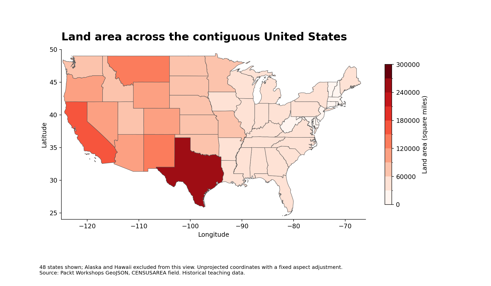

# CHEN YU 陳鈺

**Data Science Portfolio · CISC7204 · mc644339**

I am learning to turn data into clear, reproducible explanations. My coursework explores Python data analysis and geospatial visualization. This portfolio shows how I document a research question, examine data, communicate findings, and state the limits of an analysis.

## Technical skills

Python · pandas · NumPy · Matplotlib · GeoJSON · Jupyter Notebook · geospatial visualization

I use these tools in coursework and am developing my skills in GitHub documentation and reproducible workflows.

## Featured project

### US State Land Area Analysis

**Research question:** How does land area vary across US states, and what does a contiguous-US map leave out?

**Status:** Completed analysis. Clarified after an AI-simulated review; real classmate review remains pending.

**Main finding:** Alaska is the largest US state by land area in this dataset. Texas is the largest within the contiguous-US map, but the national ranking changes when Alaska is included. Alaska has 570,640.950 square miles of land area, compared with 261,231.711 for Texas: about 2.18 times as much. Comparing a map with a ranked chart makes that difference explicit.

**How to read the figures:** Darker red indicates greater land area, not population. The map displays 48 contiguous states; Alaska and Hawaii are omitted from its extent. The bar chart ranks all 50 states, including Alaska and Hawaii. The District of Columbia and Puerto Rico are excluded from the ranking. Values come from the same CENSUSAREA field in both figures.

**Limitation:** The data is a historical teaching snapshot. The map is not an equal-area projection, and its colours do not represent population. Use the numerical ranking for area comparisons rather than measuring polygon sizes on screen.

[View the project code, dataset attribution, and reproduction instructions](https://github.com/hc111874-art/data-science-project)

## Review and improvement

An AI-simulated reader review identified the purpose (compare state land areas), main finding (Alaska leads nationally while Texas leads in the contiguous view), and limitation (historical data and a non-equal-area map). It suggested adding exact values and explaining why the map and chart show different geographic coverage. I added the Alaska-to-Texas numerical comparison and an explicit guide to the coverage and units. This is simulated feedback, not feedback from a classmate.

## What I will improve next

I will ask a classmate to identify the project's purpose, main finding, and limitation. After receiving their feedback, I will make an improvement and record it with a descriptive commit. I also plan to explore an equal-area projection and clearer treatment of Alaska and Hawaii.

## Transparency

The project extends my Exercise 8.02 coursework. OpenAI Codex assisted with the portfolio extension, code organization, visualizations, and documentation. Dataset provenance and the upstream MIT permission notice are included in the project repository. No peer feedback is claimed before it has been received.
